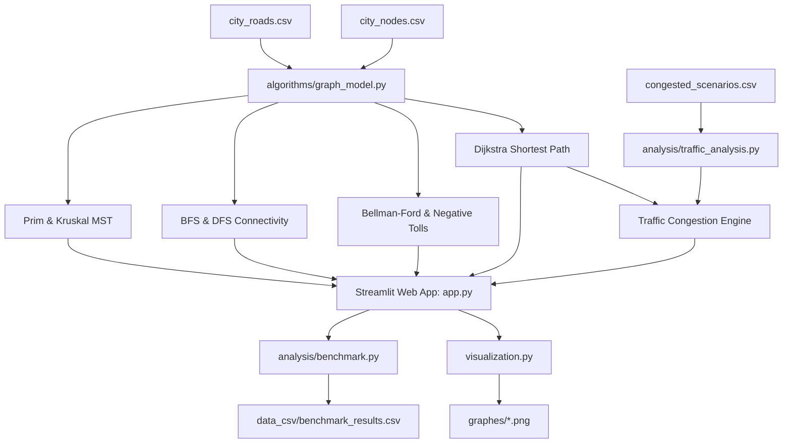

# Smart City Traffic Management and Route Optimization System

[](https://www.python.org/)
[](https://streamlit.io/)
[](https://networkx.org/)
[](LICENSE)
[]()

> **Course:** Design and Analysis of Algorithms (DAA)  
> **Lab 5:** Capstone Assignment — Option A  
> **Author:** Bhavya Rattan (Roll No: 2401201004)  
> **Repository:** [bhavyarattan21/smart-city-traffic-optimization](https://github.com/bhavyarattan21/smart-city-traffic-optimization)

---

## 📌 1. Project Overview

Modern urban metropolises face exponential vehicular volume growth, leading to recurrent traffic bottlenecks, excessive fuel consumption, greenhouse emissions, and inefficient capital expenditure on road maintenance. 

This Capstone Project develops an **Intelligent Smart City Traffic Management and Route Optimization System** that models an urban road grid as a weighted graph $G = (V, E)$ and applies core algorithmic techniques:
- **Phase 1 (Graph Modeling):** Dual representation using **Adjacency Lists** (memory-efficient $O(V+E)$ for sparse networks) and **Adjacency Matrices** ($O(V^2)$ table with $O(1)$ edge lookups).
- **Phase 2 (Route Planning & Traffic Simulation):** Single-source shortest path planning via **Dijkstra's Algorithm** (Min-Priority Queue) and **Bellman-Ford Algorithm** (negative toll incentives & cycle detection), coupled with a dynamic **Congestion Simulation Engine**.
- **Phase 3 (Network Connectivity Analysis):** **Breadth-First Search (BFS)** for layer-by-layer exploration and hop-count reachability, and **Depth-First Search (DFS)** for deep-branch traversal and connected component auditing.
- **Phase 4 (Infrastructure Budget Optimization):** **Prim's Algorithm** (cut-property min-heap) and **Kruskal's Algorithm** (edge sorting with Disjoint Set Union-Find and path compression) to determine the Minimum Spanning Tree (MST) for minimal maintenance costs.
- **Phase 5 (Visual Interfaces & Reporting):** Interactive **Streamlit Web Dashboard**, an interactive **CLI Menu**, cartographic graph visualizers, and empirical benchmarking suite across scaling graphs ($V=10$ to $V=150$).

---

## 🏗️ 2. System Architecture



---

## 📊 3. Algorithmic Complexity Comparison Table

| Phase | Algorithm | Time Complexity | Space Complexity | Practical Urban Application |
| :--- | :--- | :--- | :--- | :--- |
| **Phase 1** | **Adjacency List** | $\mathcal{O}(V + E)$ | $\mathcal{O}(V + E)$ | Optimal for sparse arterial road topologies |
| **Phase 1** | **Adjacency Matrix** | $\mathcal{O}(V^2)$ | $\mathcal{O}(V^2)$ | Fast $\mathcal{O}(1)$ adjacency lookups in dense downtown cores |
| **Phase 2** | **Dijkstra's Algorithm** | $\mathcal{O}((V + E) \log V)$ | $\mathcal{O}(V + E)$ | Real-time vehicle navigation under positive travel times |
| **Phase 2** | **Bellman-Ford Algorithm** | $\mathcal{O}(V \cdot E)$ | $\mathcal{O}(V)$ | Modeling green corridor toll credits & cycle detection |
| **Phase 2** | **Congestion Simulation** | $\mathcal{O}((V + E) \log V)$ | $\mathcal{O}(V + E)$ | Dynamic rerouting evaluation under incident bottlenecks |
| **Phase 3** | **Breadth-First Search (BFS)** | $\mathcal{O}(V + E)$ | $\mathcal{O}(V)$ | Minimum-hop routing for emergency medical dispatch |
| **Phase 3** | **Depth-First Search (DFS)** | $\mathcal{O}(V + E)$ | $\mathcal{O}(V)$ | Detecting isolated urban zones and network partitions |
| **Phase 4** | **Prim's Algorithm (MST)** | $\mathcal{O}(E \log V)$ | $\mathcal{O}(V + E)$ | Spanning tree design on dense street sub-networks |
| **Phase 4** | **Kruskal's Algorithm (MST)** | $\mathcal{O}(E \log E)$ | $\mathcal{O}(V + E)$ | Infrastructure planning on sparse regional transit grids |

---

## 📁 4. Project File Structure

```text
DAA capstone assign/
│
├── algorithms/                    # Core Algorithmic Implementations
│   ├── __init__.py                # Package exports
│   ├── graph_model.py             # Phase 1: CityGraph (List & Matrix, CSV parser)
│   ├── shortest_path.py           # Phase 2: Dijkstra, Bellman-Ford, Congestion Sim
│   ├── traversal.py               # Phase 3: BFS, DFS, Reachability & Components
│   └── mst.py                     # Phase 4: Prim's, Kruskal's MST & Union-Find
│
├── analysis/                      # Empirical Benchmarks & Scenario Analytics
│   ├── benchmark.py               # Automated scaling benchmark (V=10 to V=150)
│   └── traffic_analysis.py        # Predefined urban incident evaluation
│
├── data_csv/                      # Input & Output Datasets
│   ├── city_nodes.csv             # 10 Intersections with coordinates & functional zones
│   ├── city_roads.csv             # 19 Arterial roads with travel weights & lane counts
│   ├── congested_scenarios.csv    # Real-world traffic disruption scenarios
│   ├── traffic_impact_results.csv # Generated traffic delay & rerouting metrics
│   └── benchmark_results.csv      # Empirical execution timing data
│
├── graphes/                       # Generated High-Resolution Publication Plots
│   ├── city_road_network.png      # Base cartographic road network
│   ├── dijkstra_shortest_route.png# Route highlight from Downtown to Airport
│   ├── traffic_congestion_reroute.png # Side-by-side Before/After rerouting comparison
│   ├── mst_prim_vs_kruskal.png    # Prim's vs Kruskal's MST visual verification
│   ├── bfs_reachability_tree.png  # BFS hop-by-hop exploration tree
│   ├── dfs_exploration_tree.png   # DFS deep-branch exploration tree
│   └── benchmark_comparison.png   # Logarithmic runtime scaling curves
│
├── tests/                         # Automated Unit & Integration Tests
│   └── test_algorithms.py         # 11 Unit tests covering edge cases & correctness
│
├── app.py                         # Phase 5: Streamlit Interactive Web Application
├── cli.py                         # Phase 5: Menu-Driven Terminal Interface
├── visualization.py               # Publication-grade Matplotlib/NetworkX visualizer
├── CAPSTONE_REPORT.md             # Complete formal academic evaluation report
├── requirements.txt               # Dependencies (networkx, matplotlib, streamlit, etc.)
├── .gitignore                     # Git ignore rules
└── README.md                      # Comprehensive project documentation
```

---

## 🚀 5. Installation & Execution Guide

### Prerequisites
- Python 3.10, 3.11, 3.12, 3.13, or 3.14
- Standard `pip` package manager

### Step 1: Clone or Open Workspace
```bash
git clone https://github.com/bhavyarattan21/smart-city-traffic-optimization.git
cd "DAA capstone assign"
```

### Step 2: Install Dependencies
```bash
pip install -r requirements.txt
```

### Step 3: Run Interactive Streamlit Web Application
```bash
streamlit run app.py
```
Open your browser at `http://localhost:8501` to access the interactive dashboard.

### Step 4: Run Interactive CLI Menu
```bash
python cli.py
```

### Step 5: Execute Automated Test Suite
```bash
python -m unittest discover tests -v
```

### Step 6: Run Empirical Benchmarks & Scenario Analysis
```bash
# Run scalability benchmarks across V=10 to V=150
python -m analysis.benchmark

# Run predefined real-world traffic incident simulations
python -m analysis.traffic_analysis

# Generate all visual maps and PNG plots
python visualization.py
```

---

## 🔬 6. Key Experimental Findings

1. **Traffic Congestion & Rerouting:**
   - Under incident scenario `SCEN_01` (Morning Rush Hour on edge `B-C` with $5\times$ slowdown from $1.0$m to $5.0$m), the optimal route from Downtown (`A`) to University (`D`) automatically diverted from `A -> C -> B -> D` ($8.0$m) to `A -> B -> D` ($9.0$m), avoiding an otherwise severe $12.0$m bottleneck.
2. **Infrastructure Maintenance Optimization:**
   - The full municipal road network consists of $19$ arterial roads totaling **$74.0$ km** of roadway.
   - Both Prim's and Kruskal's algorithms converged on the identical global Minimum Spanning Tree of $9$ edges costing **$40.0$ km**.
   - This delivers an immediate **$45.9\%$ capital expenditure reduction** for annual resurfacing and maintenance while ensuring $100\%$ urban district connectivity.
3. **Empirical Algorithmic Scaling:**
   - Dijkstra's min-heap implementation maintained sub-millisecond execution ($0.85$ ms at $V=150, E=2960$), scaling strictly with $\mathcal{O}((V+E)\log V)$.
   - Bellman-Ford execution scaled quadratically with edge relaxations, reaching $4.48$ ms at $V=150$, empirically demonstrating the performance trade-off for negative toll credit versatility.

---

## 📜 7. Academic Integrity & Author Details

- **Student:** Bhavya Rattan
- **Roll Number:** 2401201004
- **Program:** B.Tech Computer Science & Engineering
- **Institution:** Department of Computer Science & Engineering
- **Evaluation:** DAA Lab 5 Capstone Assignment (Submitted via GitHub & ZOSIMA)
